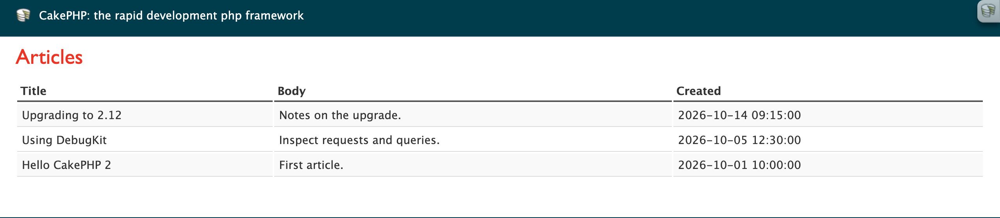
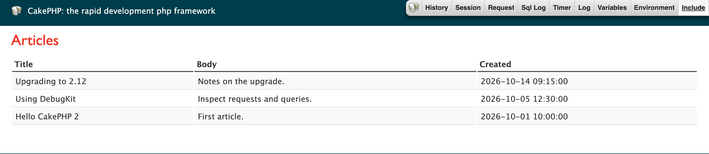
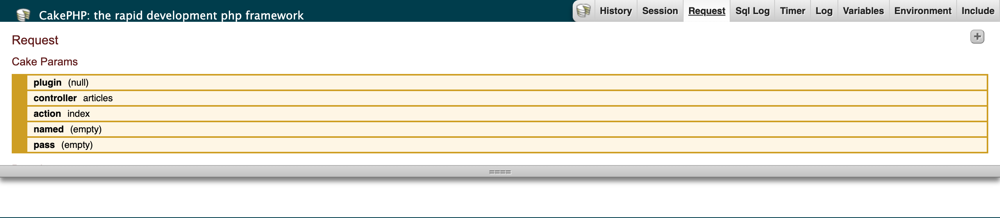
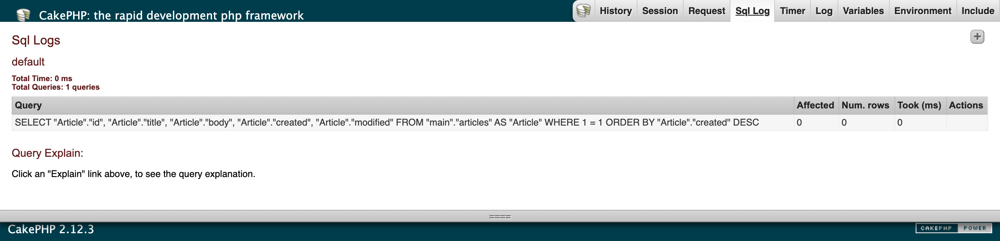
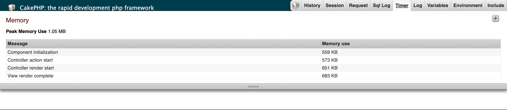
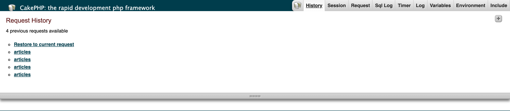

# DebugKit Documentation

DebugKit adds a debugging toolbar to CakePHP 2 applications. This plugin is a fork of
[cakephp/debug_kit](https://github.com/cakephp/debug_kit) for
[pieceofcake2/cakephp](https://github.com/pieceofcake2/cakephp). The original
documentation for the 2.x line is in the
[upstream 2.2 branch README](https://github.com/cakephp/debug_kit/blob/2.2/README.md).

- [Installation](#installation)
- [Toolbar Panels](#toolbar-panels)
- [Configuration](#configuration)
- [Developing Your Own Panels](#developing-your-own-panels)
- [Cache Engine](#cache-engine)
- [Toolbar Screenshots (2.2.x)](#toolbar-screenshots-22x)

## Installation

Install the plugin with [Composer](https://getcomposer.org/):

```
composer require --dev pieceofcake2/debug_kit
```

The plugin has the `cakephp-plugin` type, so it is installed into your plugins directory
by `composer/installers`. Set `installer-paths` in your application's `composer.json` so it
is installed into the right place:

| Layout | `installer-paths` |
| --- | --- |
| Modern (`config/`, `src/`, `templates/`, `plugins/`) | `"plugins/{$name}/": ["type:cakephp-plugin"]` |
| Legacy (`app/Config/`, `app/Plugin/`) | `"app/Plugin/{$name}/": ["type:cakephp-plugin"]` |

### Enable the plugin

Load the plugin in `config/bootstrap.php` (legacy layout: `app/Config/bootstrap.php`).
If you already use `CakePlugin::loadAll()`, this is not necessary:

```php
CakePlugin::load('DebugKit');
```

Add the toolbar component to `src/Controller/AppController.php` (legacy layout:
`app/Controller/AppController.php`):

```php
class AppController extends Controller
{
    public $components = ['DebugKit.Toolbar'];
}
```

The toolbar is shown when `debug` is 1 or higher in `config/core.php`.

Remove the `sql_dump` element from your layout (usually `templates/Layouts/default.ctp`,
legacy layout: `app/View/Layouts/default.ctp`). The element empties the query log before
the Sql Log panel reads it, so the panel would show "No query logs".

## Toolbar Panels

The toolbar is made up of several panels, which are shown by clicking the CakePHP icon
in the upper right-hand corner of the page. Each panel consists of a panel class and a
view element. Typically a panel collects and displays a single type of information, such
as logs or request information. You can choose which panels are shown and add your own.

### Built-in Panels

- **History**: Allows access to previous request information, useful when debugging
  actions with redirects.
- **Session**: Displays the information currently in the session.
- **Request**: Displays information about the current request: GET, POST, Cake
  parameters, current route information, and cookies if `CookieComponent` is in your
  controller's components.
- **Sql Log**: Displays the SQL log for each database connection.
- **Timer**: Displays any timers that were set during the request (see
  `DebugKitDebugger`), the memory used at component callbacks, and the peak memory use.
- **Log**: Displays the log entries written during the request.
- **Variables**: Displays the view variables set in the controller.
- **Environment**: Displays environment variables related to PHP and CakePHP.
- **Include**: Displays the included files, grouped by type.

## Configuration

Settings are passed in the component declaration like any other component settings:

```php
public $components = [
    'DebugKit.Toolbar' => [/* settings */],
];
```

### Controlling Panels

The `panels` key sets which panels are loaded and in which order:

```php
public $components = [
    'DebugKit.Toolbar' => ['panels' => ['MyCustom', 'timer' => false]],
];
```

This adds your custom panel `MyCustomPanel` and removes the built-in Timer panel.

Other keys are passed to the panels' constructors. For example, the built-in History
panel uses the `history` key to set the number of past requests to keep:

```php
public $components = [
    'DebugKit.Toolbar' => ['history' => 10],
];
```

The `panels` key itself is not passed to the panel constructors.

### forceEnable

`forceEnable` shows the toolbar regardless of `Configure::read('debug')`. This is useful
when profiling an application in production mode:

```php
public $components = [
    'DebugKit.Toolbar' => ['forceEnable' => true],
];
```

### autoRun

`autoRun` controls whether the toolbar runs automatically. Set it to `false` to enable the
toolbar only when the URL has the `?debug=true` query string:

```php
public $components = [
    'DebugKit.Toolbar' => ['autoRun' => false],
];
```

## Developing Your Own Panels

### Panel Classes

Panel classes are placed in the `Panel` directory inside a `Lib` path. The file name must
match the class name, so `MyCustomPanel` is expected in `src/Lib/Panel/MyCustomPanel.php`
(legacy layout: `app/Lib/Panel/MyCustomPanel.php`). Panels must extend `DebugPanel`:

```php
App::uses('DebugPanel', 'DebugKit.Lib');

class MyCustomPanel extends DebugPanel
{
}
```

See also the example panel in
`tests/test_app/Plugin/DebugkitTestPlugin/Lib/Panel/PluginTestPanel.php`.

Panels can define the `css` and `javascript` properties (arrays) to include additional
CSS or JavaScript on the page:

```php
class MyCustomPanel extends DebugPanel
{
    public $javascript = [
        '/my_plugin/js/custom_panel.js',
    ];
}
```

### Callbacks

Panels have two callbacks that let them inspect the current request:

- `startup(Controller $controller)` is called during the component's `startup()`.
- `beforeRender(Controller $controller)` is called during the component's
  `beforeRender()`. Its return value is passed to the panel element as `$content`, so you
  do not need to set view variables yourself.

```php
/**
 * Grabs the request parameters.
 *
 * @param \Controller $controller The controller.
 * @return array
 */
public function beforeRender(Controller $controller)
{
    return $controller->request->params;
}
```

### Panel Elements

Each panel has a view element that renders the content returned by the panel. The element
name is the underscored class name: `SessionPanel` uses `session_panel.ctp`, and
`SqlLogPanel` uses `sql_log_panel.ctp`. Put the elements in your `Elements` directory.

Panels pick up their title and element name by convention. To change them, set these
properties:

- `$title`: the title used for the panel's button in the toolbar.
- `$elementName`: the element used to render the panel.

### Panels in Plugins

Panels provided by a plugin work the same way, but must set `$plugin` to the plugin name
so that their elements can be found:

```php
class MyCustomPanel extends DebugPanel
{
    public $plugin = 'MyPlugin';
}
```

Use plugin dot notation to load a plugin panel:

```php
public $components = [
    'DebugKit.Toolbar' => ['panels' => ['MyPlugin.MyCustom']],
];
```

This loads all default panels and the custom panel from `MyPlugin`.

## Cache Engine

DebugKit uses the File cache engine for its internal caching by default. Use the `cache`
key to use another engine. Any engine supported by `Cache::config()` works:

```php
public $components = [
    'DebugKit.Toolbar' => [
        'cache' => ['engine' => 'Memcached', 'servers' => ['127.0.0.1:11211']],
    ],
];
```

## Toolbar Screenshots (2.2.x)

The toolbar as shipped in the 2.2.x releases.

Collapsed: the CakePHP icon in the upper right-hand corner.



Expanded: one button per panel.



Request panel:



Sql Log panel:



Timer panel:



History panel:


