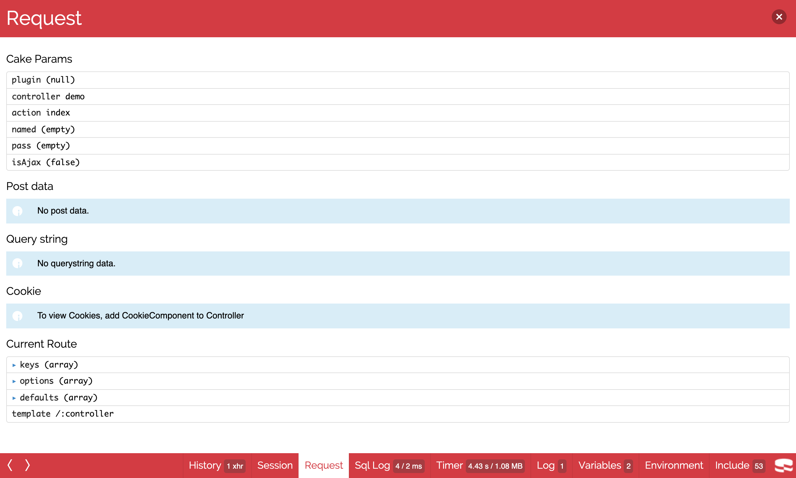
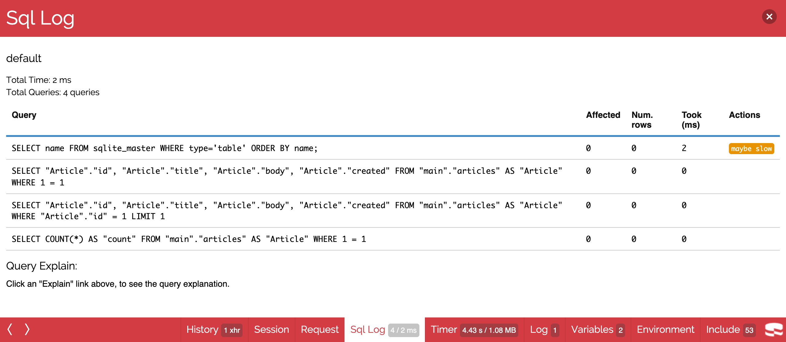
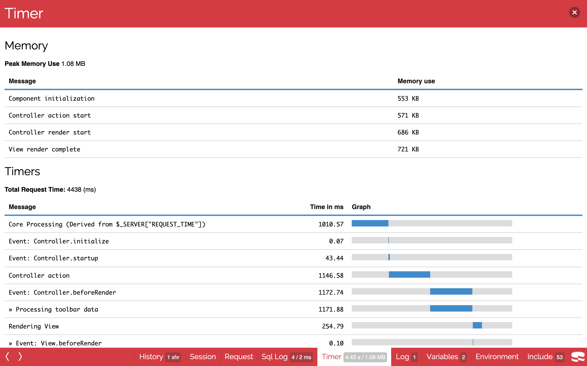
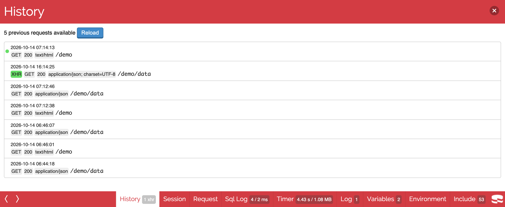

# DebugKit Documentation

DebugKit adds a debugging toolbar to CakePHP 2 applications. This plugin is a fork of
[cakephp/debug_kit](https://github.com/cakephp/debug_kit) for
[pieceofcake2/cakephp](https://github.com/pieceofcake2/cakephp).

- [Installation](#installation)
- [The Toolbar](#the-toolbar)
- [Toolbar Panels](#toolbar-panels)
- [Configuration](#configuration)
- [Request History Storage](#request-history-storage)
- [Developing Your Own Panels](#developing-your-own-panels)
- [Cache Engine](#cache-engine)
- [Upgrading from 2.2.x](#upgrading-from-22x)
- [Credits](#credits)
- [Toolbar Screenshots (2.3.x)](#toolbar-screenshots-23x)
- [Toolbar Screenshots (2.2.x)](#toolbar-screenshots-22x)

## Installation

Install the plugin with [Composer](https://getcomposer.org/):

```
composer require --dev pieceofcake2/debug_kit
```

The plugin has the `cakephp-plugin` type, so it is installed into your plugins directory
by `composer/installers`. Set `installer-paths` in your application's `composer.json` so it
is installed into the right place:

| Layout | `installer-paths` |
| --- | --- |
| Modern (`config/`, `src/`, `templates/`, `plugins/`) | `"plugins/{$name}/": ["type:cakephp-plugin"]` |
| Legacy (`app/Config/`, `app/Plugin/`) | `"app/Plugin/{$name}/": ["type:cakephp-plugin"]` |

### Enable the plugin

Load the plugin in `config/bootstrap.php` (legacy layout: `app/Config/bootstrap.php`).
If you already use `CakePlugin::loadAll()`, this is not necessary:

```php
CakePlugin::load('DebugKit');
```

Add the toolbar component to `src/Controller/AppController.php` (legacy layout:
`app/Controller/AppController.php`):

```php
class AppController extends Controller
{
    public $components = ['DebugKit.Toolbar'];
}
```

The toolbar is shown when `debug` is 1 or higher in `config/core.php`.

Remove the `sql_dump` element from your layout (usually `templates/Layouts/default.ctp`,
legacy layout: `app/View/Layouts/default.ctp`). The element empties the query log before
the Sql Log panel reads it, so the panel would show "No query logs".

## The Toolbar

Since 2.3.0 the toolbar has the look and the architecture of DebugKit 5 (cakephp/debug_kit
5.x), adapted to CakePHP 2:

- A small CakePHP icon is shown in the bottom right-hand corner of HTML pages. Clicking it
  opens the toolbar with one button per panel along the bottom of the page. Clicking a
  button slides the panel content up. <kbd>Esc</kbd> closes the panel or the toolbar, the
  arrow keys switch between panels.
- The toolbar is rendered inside an iframe, so the CSS and JavaScript of your application
  cannot break the toolbar, and the toolbar cannot break your application.
- At the end of each request (`ToolbarComponent::shutdown()`, or `beforeRedirect()` for
  redirects) the panels are rendered and saved in the
  [request history storage](#request-history-storage), and a small loader script
  (`webroot/js/inject-iframe.js`) is inserted before `</body>`. The toolbar
  (`/debug_kit/requests/view/<id>`) and each panel (`/debug_kit/panels/view/<id>/<panel>`)
  are then loaded with separate requests to the plugin's controllers.
- Every recorded response has an `X-DEBUGKIT-ID` header. Ajax requests made by the page
  (`XMLHttpRequest` and `fetch()`) are listed in the History panel, and selecting any
  request in the History panel shows its panels in the toolbar.
- The toolbar is only inserted into HTML responses. JSON, XML, ajax, `requestAction()`
  and redirect responses are recorded (so they can be inspected from the History panel)
  but are left untouched. Requests to the DebugKit plugin itself are not recorded.

The plugin controllers rely on the default plugin routes (`/:plugin/:controller/:action/*`),
which are loaded by `require CAKE . 'Config' . DS . 'routes.php';` in your `routes.php`.


## Toolbar Panels

The toolbar is made up of several panels, which are shown by clicking the CakePHP icon
in the bottom right-hand corner of the page. Each panel consists of a panel class and a
view element. Typically a panel collects and displays a single type of information, such
as logs or request information. You can choose which panels are shown and add your own.

### Built-in Panels

- **History**: Lists the previous requests (including redirects and ajax requests) and
  shows their panels in the toolbar, useful when debugging actions with redirects.
- **Session**: Displays the information currently in the session.
- **Request**: Displays information about the current request: GET, POST, Cake
  parameters, current route information, and cookies if `CookieComponent` is in your
  controller's components.
- **Sql Log**: Displays the SQL log for each database connection.
- **Timer**: Displays any timers that were set during the request (see
  `DebugKitDebugger`), the memory used at component callbacks, and the peak memory use.
- **Log**: Displays the log entries written during the request.
- **Variables**: Displays the view variables set in the controller.
- **Environment**: Displays environment variables related to PHP and CakePHP.
- **Include**: Displays the included files, grouped by type.

## Configuration

Settings are passed in the component declaration like any other component settings:

```php
public $components = [
    'DebugKit.Toolbar' => [/* settings */],
];
```

### Controlling Panels

The `panels` key sets which panels are loaded and in which order:

```php
public $components = [
    'DebugKit.Toolbar' => ['panels' => ['MyCustom', 'timer' => false]],
];
```

This adds your custom panel `MyCustomPanel` and removes the built-in Timer panel.

Other keys are passed to the panels' constructors. For example, the built-in History
panel uses the `history` key to set the number of past requests it lists:

```php
public $components = [
    'DebugKit.Toolbar' => ['history' => 10],
];
```

The `panels` key itself is not passed to the panel constructors.

### forceEnable

`forceEnable` shows the toolbar regardless of `Configure::read('debug')`. This is useful
when profiling an application in production mode:

```php
public $components = [
    'DebugKit.Toolbar' => ['forceEnable' => true],
];
```

### autoRun

`autoRun` controls whether the toolbar runs automatically. Set it to `false` to enable the
toolbar only when the URL has the `?debug=true` query string:

```php
public $components = [
    'DebugKit.Toolbar' => ['autoRun' => false],
];
```

### forceEnable without debug mode

The toolbar endpoints (`/debug_kit/requests/...`, `/debug_kit/panels/...`) are only
available in debug mode. To use `forceEnable` with `debug` set to 0, also write the
setting to `Configure` so that the endpoints are enabled:

```php
Configure::write('DebugKit.forceEnable', true);
```

## Request History Storage

The recorded requests and their rendered panels are stored in a SQLite database,
`TMP/debug_kit.sqlite` (usually `tmp/debug_kit.sqlite`). The `debug_kit` connection is
created with `ConnectionManager::create()` and the tables are created automatically. Only
the latest 20 requests are kept.

When the PDO SQLite driver is not available (or the database cannot be created), the
requests are stored in the `debug_kit` cache configuration instead (see
[Cache Engine](#cache-engine)). When neither is available, the request is not recorded
and the toolbar is not shown.

| Setting | Default | Description |
| --- | --- | --- |
| `requestCount` | `20` | Number of requests to keep. |
| `storage` | `auto` | `auto` uses the database and falls back to the cache, `database` or `cache` force one of them. |
| `connection` | `debug_kit` | Connection name. If your `database.php` defines a connection with this name, it is used (and the tables are created in it) instead of the SQLite file. On MySQL, the panel content column is created as `LONGTEXT`, because `TEXT` holds at most 64 KB. |
| `database` | `TMP . 'debug_kit.sqlite'` | SQLite file used when the connection is created. |

The toolbar endpoints only read `Configure::read('DebugKit')`, so put storage settings
there (the component reads it too) rather than in the component settings:

```php
Configure::write('DebugKit', [
    'requestCount' => 50,
    'database' => TMP . 'debug_kit' . DS . 'requests.sqlite',
]);
```

## Developing Your Own Panels

### Panel Classes

Panel classes are placed in the `Panel` directory inside a `Lib` path. The file name must
match the class name, so `MyCustomPanel` is expected in `src/Lib/Panel/MyCustomPanel.php`
(legacy layout: `app/Lib/Panel/MyCustomPanel.php`). Panels must extend `DebugPanel`:

```php
App::uses('DebugPanel', 'DebugKit.Lib');

class MyCustomPanel extends DebugPanel
{
}
```

See also the example panel in
`tests/test_app/Plugin/DebugkitTestPlugin/Lib/Panel/PluginTestPanel.php`.

Panels can define the `css` and `javascript` properties (arrays) to include additional
CSS or JavaScript in the toolbar. They are loaded into the toolbar iframe, not into your
page:

```php
class MyCustomPanel extends DebugPanel
{
    public $javascript = [
        '/my_plugin/js/custom_panel.js',
    ];
}
```

### Callbacks

Panels have two callbacks that let them inspect the current request:

- `startup(Controller $controller)` is called during the component's `startup()`.
- `beforeRender(Controller $controller)` is called during the component's
  `beforeRender()`. Its return value is passed to the panel element as `$content`, so you
  do not need to set view variables yourself.

```php
/**
 * Grabs the request parameters.
 *
 * @param \Controller $controller The controller.
 * @return array
 */
public function beforeRender(Controller $controller)
{
    return $controller->request->params;
}
```

Panels can also return a short summary, which is shown next to the panel's button in the
toolbar (for example the number of queries of the Sql Log panel):

```php
/**
 * @param mixed $content The content returned by beforeRender().
 * @return string
 */
public function summary($content = null)
{
    return (string)count($content);
}
```

### Panel Elements

Each panel has a view element that renders the content returned by the panel. The element
name is the underscored class name: `SessionPanel` uses `session_panel.ctp`, and
`SqlLogPanel` uses `sql_log_panel.ctp`. Put the elements in your `Elements` directory.

The element is rendered at the end of the request, with the view of the request when the
page is rendered with the HTML toolbar, and the rendered HTML is stored. The toolbar shows
it inside `<div class="panel-content" id="<panel>-tab">`, where `<panel>` is the
underscored panel name. The toolbar does not include jQuery or any other library, so
panel JavaScript must bundle what it needs. Every time a panel has been loaded, an
`initPanel` event is dispatched on `document` with the panel name prefixed with `panel` as
`detail` (for example `panelmy_custom`):

```js
document.addEventListener('initPanel', (event) => {
  if (event.detail !== 'panelmy_custom') {
    return;
  }
  document.querySelectorAll('#my_custom-tab .my-row').forEach((row) => {
    // ...
  });
});
```

`<script>` elements of the panel content are run when the panel is loaded.

Panels pick up their title and element name by convention. To change them, set these
properties:

- `$title`: the title used for the panel's button in the toolbar.
- `$elementName`: the element used to render the panel.

### Panels in Plugins

Panels provided by a plugin work the same way, but must set `$plugin` to the plugin name
so that their elements can be found:

```php
class MyCustomPanel extends DebugPanel
{
    public $plugin = 'MyPlugin';
}
```

Use plugin dot notation to load a plugin panel:

```php
public $components = [
    'DebugKit.Toolbar' => ['panels' => ['MyPlugin.MyCustom']],
];
```

This loads all default panels and the custom panel from `MyPlugin`.

## Cache Engine

DebugKit uses the File cache engine for its internal caching by default: the legacy
toolbar state (`ToolbarComponent::loadState()`, `ToolbarHelper::readCache()`) and the
request history when the [cache storage](#request-history-storage) is used. Use the
`cache` key to use another engine. Any engine supported by `Cache::config()` works:

```php
public $components = [
    'DebugKit.Toolbar' => [
        'cache' => ['engine' => 'Memcached', 'servers' => ['127.0.0.1:11211']],
    ],
];
```

## Upgrading from 2.2.x

2.3.0 replaces the toolbar but keeps the PHP API. Panel classes extending `DebugPanel`,
their elements, the component settings, `DebugTimer`, `DebugMemory`, `DebugKitDebugger`,
FireCake and the `ToolbarAccess` controller keep working. Behaviour changes:

- The toolbar is shown in an iframe in the bottom right-hand corner instead of being
  rendered into the page, and it is inserted on `Controller.shutdown` instead of
  `View.afterLayout`. Pages rendered without a layout now get the toolbar too, as long as
  they are HTML and have a `</body>` tag.
- `HtmlToolbarHelper::send()` does nothing anymore; ajax and non HTML requests still use
  FirePHP (`FirePhpToolbarHelper`) as before.
- The request history is kept in the request history storage (`tmp/debug_kit.sqlite`)
  and is shared by all clients instead of being kept per user agent in the cache. The
  `History` panel content changed accordingly. The legacy cache state is still written,
  `ToolbarComponent::loadState()` and `ToolbarAccessController::history_state()` are
  deprecated.
- `webroot/js/js_debug_toolbar.js` and `webroot/css/debug_toolbar.css` were removed, the
  toolbar uses `webroot/css/style.css` and `webroot/js/main.js`. The default values of
  `ToolbarComponent::$javascript` and `ToolbarComponent::$css` are now empty arrays; they
  list additional assets loaded into the toolbar iframe.
- The toolbar no longer ships jQuery, nor the `DEBUGKIT` JavaScript API of the 2.x
  toolbar (`DEBUGKIT.module()`, `DEBUGKIT.loader`, `DEBUGKIT.$`, `DEBUGKIT.Util.Cookie`,
  ...). Panel `css`/`javascript` files (`DebugPanel::$css`, `DebugPanel::$javascript`) are
  still loaded into the toolbar iframe, but panel JavaScript must not rely on jQuery or the
  old API: bundle what it needs and use the `initPanel` event (see
  [Panel Elements](#panel-elements)) instead of `DEBUGKIT.loader.register()`.
- The built-in elements no longer print their own `<h2>` title, the toolbar shows the
  panel title.
- `ToolbarHelper::getQueryLogs()` no longer clears the query log of the connection.
- The `debug_kit` connection is not listed by the Sql Log panel.

## Credits

The toolbar look and architecture are ported from
[cakephp/debug_kit](https://github.com/cakephp/debug_kit) 5.x, Copyright (c) Cake Software
Foundation, Inc., MIT License. The copied and adapted files keep the original copyright
notice; see [NOTICE](../NOTICE) for the list. The Raleway font is licensed under the SIL
Open Font License 1.1 (`webroot/css/raleway-OFL.txt`).

## Toolbar Screenshots (2.3.x)

The toolbar since 2.3.0.

Collapsed: the CakePHP icon in the bottom right-hand corner.


Expanded: one button per panel, with a summary next to some of them.


Request panel:



Sql Log panel:



Timer panel:



History panel, with an ajax request made by the page:



## Toolbar Screenshots (2.2.x)

The toolbar as shipped in the 2.2.x releases.

Collapsed: the CakePHP icon in the upper right-hand corner.


Expanded: one button per panel.


Request panel:


Sql Log panel:


Timer panel:


History panel:


