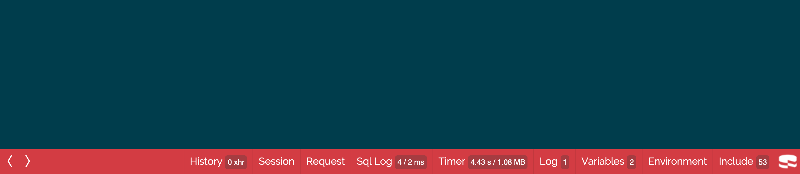

# DebugKit Documentation

DebugKit adds a debugging toolbar to CakePHP 2 applications. This plugin is a fork of
[cakephp/debug_kit](https://github.com/cakephp/debug_kit) for
[pieceofcake2/cakephp](https://github.com/pieceofcake2/cakephp).

- [Installation](#installation)
- [The Toolbar](#the-toolbar)
- [Panels](panels.md): the built-in panels and developing your own panels
- [Configuration](configuration.md): the toolbar settings, the request history storage and the cache engine
- [Upgrading from 2.2.x](upgrading.md)
- [Toolbar Screenshots](screenshots.md) of 2.3.x and 2.2.x
- [Credits](#credits)

## Installation

Install the plugin with [Composer](https://getcomposer.org/):

```bash
composer require --dev pieceofcake2/debug_kit
```

The plugin has the `cakephp-plugin` type, so it is installed into your plugins directory
by `composer/installers`. Set `installer-paths` in your application's `composer.json` so it
is installed into the right place:

| Layout | `installer-paths` |
| --- | --- |
| Modern (`config/`, `src/`, `templates/`, `plugins/`) | `"plugins/{$name}/": ["type:cakephp-plugin"]` |
| Legacy (`app/Config/`, `app/Plugin/`) | `"app/Plugin/{$name}/": ["type:cakephp-plugin"]` |

### Enable the plugin

Load the plugin in `config/bootstrap.php` (legacy layout: `app/Config/bootstrap.php`).
If you already use `CakePlugin::loadAll()`, this is not necessary:

```php
CakePlugin::load('DebugKit');
```

Add the toolbar component to `src/Controller/AppController.php` (legacy layout:
`app/Controller/AppController.php`):

```php
class AppController extends Controller
{
    public $components = ['DebugKit.Toolbar'];
}
```

The toolbar is shown when `debug` is 1 or higher in `config/core.php`.

Remove the `sql_dump` element from your layout (usually `templates/Layouts/default.ctp`,
legacy layout: `app/View/Layouts/default.ctp`). The element empties the query log before
the Sql Log panel reads it, so the panel would show "No query logs".

## The Toolbar

Since 2.3.0 the toolbar has the look and the architecture of DebugKit 5 (cakephp/debug_kit
5.x), adapted to CakePHP 2:

- A small CakePHP icon is shown in the bottom right-hand corner of HTML pages. Clicking it
  opens the toolbar with one button per panel along the bottom of the page. Clicking a
  button slides the panel content up. <kbd>Esc</kbd> closes the panel or the toolbar, the
  arrow keys switch between panels.
- The toolbar is rendered inside an iframe, so the CSS and JavaScript of your application
  cannot break the toolbar, and the toolbar cannot break your application.
- At the end of each request (`ToolbarComponent::shutdown()`, or `beforeRedirect()` for
  redirects) the panels are rendered and saved in the
  [request history storage](configuration.md#request-history-storage), and a small loader script
  (`webroot/js/inject-iframe.js`) is inserted before `</body>`. The toolbar
  (`/debug_kit/requests/view/<id>`) and each panel (`/debug_kit/panels/view/<id>/<panel>`)
  are then loaded with separate requests to the plugin's controllers.
- Every recorded response has an `X-DEBUGKIT-ID` header. Ajax requests made by the page
  (`XMLHttpRequest` and `fetch()`) are listed in the History panel, and selecting any
  request in the History panel shows its panels in the toolbar.
- The toolbar is only inserted into HTML responses. JSON, XML, ajax, `requestAction()`
  and redirect responses are recorded (so they can be inspected from the History panel)
  but are left untouched. Requests to the DebugKit plugin itself are not recorded.

The plugin controllers rely on the default plugin routes (`/:plugin/:controller/:action/*`),
which are loaded by `require CAKE . 'Config' . DS . 'routes.php';` in your `routes.php`.



## Credits

The toolbar look and architecture are ported from
[cakephp/debug_kit](https://github.com/cakephp/debug_kit) 5.x, Copyright (c) Cake Software
Foundation, Inc., MIT License. The copied and adapted files keep the original copyright
notice; see [NOTICE](../NOTICE) for the list. The Raleway font is licensed under the SIL
Open Font License 1.1 (`webroot/css/raleway-OFL.txt`).

## Origin

This package is a maintained fork of [cakephp/debug_kit](https://github.com/cakephp/debug_kit)
(`cakephp/debug_kit` on Packagist, last upstream version 2.2.9), originally by Mark Story and the
CakePHP community (Cake Software Foundation, Inc.). It is maintained for CakePHP 2 on modern PHP by
[pieceofcake2](https://github.com/pieceofcake2). Changes from the original are listed in the
[commit history since the fork](https://github.com/pieceofcake2/debug_kit/compare/80d8765...2.x).
